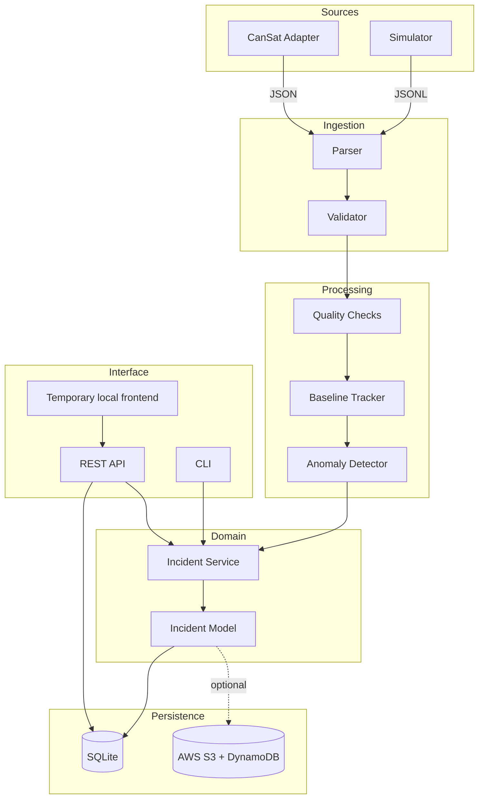
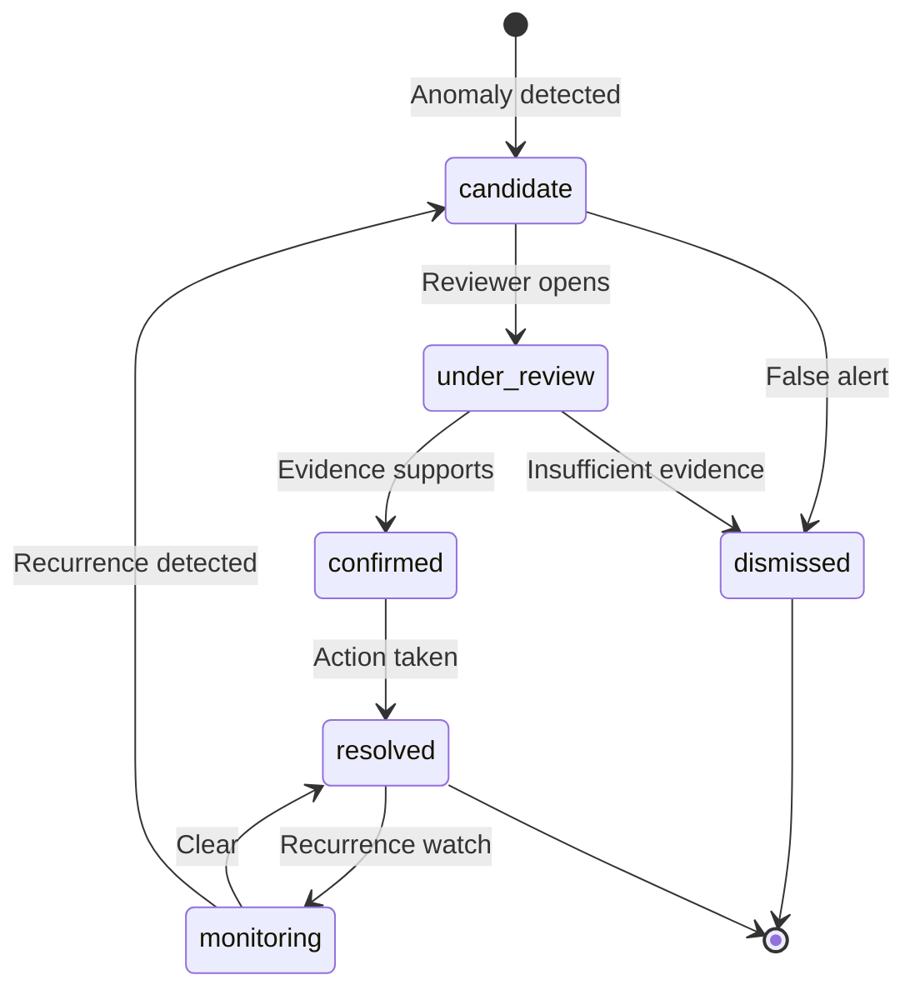

# BurnWatch Architecture

## System Context

BurnWatch is a backend system that receives environmental observations from a CanSat (or a deterministic simulator), detects relative gas-sensor anomalies, manages candidate incidents through an investigation workflow, and persists all data locally with an optional AWS storage path.

It includes a deliberately basic local frontend for exercising the REST API. It
does not include a production frontend, ML model, or official AQI calculation.

## Data Flow



## Module Responsibilities

| Module | Responsibility |
|---|---|
| `config/settings.py` | Central configuration from env vars |
| `models/observation.py` | Canonical observation schema (Pydantic) |
| `sources/base.py` | Abstract source interface |
| `sources/simulator.py` | Deterministic synthetic data generator |
| `sources/cansat.py` | CanSat replay and live adapter |
| `sources/serial.py` | Serial port connection management, framing, and alias normalization |
| `ingestion/parser.py` | JSON/JSONL parsing with error recovery |
| `ingestion/validator.py` | Schema validation and rejection |
| `quality/checks.py` | GPS, staleness, warmup, completeness flags |
| `detection/baseline.py` | Rolling median baseline tracker |
| `detection/anomaly.py` | MAD-based anomaly detector |
| `incidents/models.py` | Incident domain model and state machine |
| `incidents/service.py` | Incident lifecycle management |
| `storage/base.py` | Abstract storage interface |
| `storage/local.py` | SQLite implementation |
| `pipeline/processor.py` | End-to-end observation processing |
| `api/app.py` | FastAPI REST endpoints |
| `aws/adapter.py` | AWS S3 + DynamoDB adapter |
| `cli.py` | Click-based command-line interface |

## Observation Lifecycle

1. **Receive**: Raw JSON from simulator or CanSat adapter.
2. **Parse**: Extract fields, preserve original payload.
3. **Validate**: Schema validation via Pydantic, reject malformed.
4. **Enrich**: Add receiver timestamp, observation ID, source mode.
5. **Quality check**: Flag GPS validity, staleness, warmup, gaps.
6. **Baseline update**: Feed valid readings to rolling median tracker.
7. **Anomaly detect**: Compare against baseline using MAD threshold.
8. **Persist**: Store observation, quality flags, anomaly result.
9. **Incident evaluate**: If anomaly persists, create candidate incident.

## Source Abstraction

Both `SimulatorSource` and `CanSatSource` implement the same `ObservationSource` interface, yielding `RawObservation` records. The downstream pipeline is source-agnostic.

The source mode (`simulated` or `cansat`) is attached as metadata. Simulated observations cannot create confirmed incidents.

Switching sources requires changing `BURNWATCH_DATA_SOURCE`. The system will never silently fall back from `cansat` to `simulated`.

## Anomaly Detection

- **Method**: Rolling median with Median Absolute Deviation (MAD)
- **Signal**: MQ135 raw ADC readings
- **Threshold**: Configurable multiplier (default 3.0)
- **Warmup**: First N samples excluded from detection
- **Minimum samples**: Baseline requires M readings before detection activates
- **Zero MAD**: Falls back to minimum deviation floor
- **Persistence**: Anomaly must persist across consecutive readings before flagging
- **Cooldown**: Prevents rapid re-triggering after resolution

## Incident Lifecycle



## Persistence Design

- **Primary**: SQLite via `storage/local.py`
- **Tables**: observations, quality_flags, anomaly_results, incidents, incident_history, community_reports
- **Indexes**: device_id + sequence (uniqueness), timestamp ranges, incident status
- **Transactions**: Atomic writes for observation + flags + anomaly
- **Duplicate protection**: device_id + sequence composite key
- **AWS**: Optional parallel write to S3 (raw) + DynamoDB (incidents) via adapter

## API Boundaries

The REST API exposes only domain operations. It does not expose internal database schemas or detection internals. Request/response schemas use Pydantic models separate from internal domain models.

## AWS Integration

```
Ground station → HTTPS → API Gateway → Lambda → S3 (raw) + DynamoDB (incidents)
```

The `aws/adapter.py` implements the same storage interface as `storage/local.py`. It is behind the standard AWS credential chain and is not required for local operation.

## Failure Handling

- **Malformed records**: Logged and rejected, pipeline continues.
- **Source disconnect**: Error reported, received data preserved, no silent fallback.
- **Storage failure**: Bounded retries, clear error reporting.
- **Baseline instability**: Detection deferred until sufficient data.
- **AWS unavailable**: Graceful degradation to local storage.

## Security and Provenance

- No credentials in source code or version control.
- Every observation carries its source mode.
- Simulated data cannot produce confirmed incidents.
- No public exposure of unauthenticated API.
- Incident decisions carry reviewer identity and audit trail.

## Architecture Decisions

| Decision | Rationale |
|---|---|
| Pydantic for validation | Type safety, clear error messages, FastAPI integration |
| SQLite for local storage | Zero-config, single-file, sufficient for local workflows |
| Click for CLI | Composable commands, auto-generated help |
| Rolling median + MAD | Robust to outliers, transparent, no training required |
| Separate anomaly from incident | Prevents automated false accusations |
| Source interface abstraction | Enables testing without hardware |
