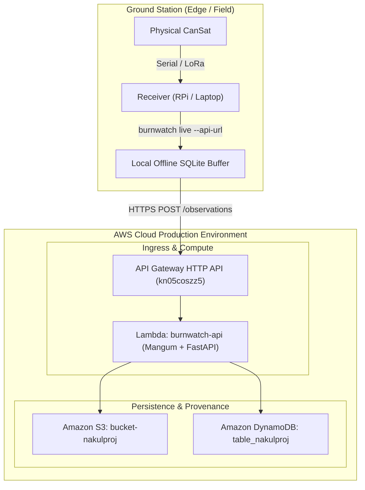

# BurnWatch — End-to-End AWS Connection, Hosting & Deployment Guide

> **✅ LIVE DEPLOYMENT — Last deployed: 2026-10-11**
>
> | Resource | Name / URL |
> |---|---|
> | **API (live)** | `https://kn05coszz5.execute-api.us-east-1.amazonaws.com` |
> | **Dashboard** | `https://kn05coszz5.execute-api.us-east-1.amazonaws.com/` |
> | **Health check** | `https://kn05coszz5.execute-api.us-east-1.amazonaws.com/health` |
> | **Lambda function** | `burnwatch-api` (us-east-1, python3.11, 512 MB) |
> | **API Gateway** | HTTP API `kn05coszz5` — catch-all `$default` route → Lambda |
> | **S3 bucket** | `bucket-nakulproj` (encrypted, public access blocked) |
> | **DynamoDB table** | `table_nakulproj` (PAY_PER_REQUEST, GSI: `status-created_at-index`) |
> | **IAM role** | `BurnWatchLambdaRole` (S3 + DynamoDB + CloudWatch logs) |
> | **AWS account** | `830523817267` / region `us-east-1` |
>
> **To redeploy after code changes:**
> ```powershell
> .\.venv\Scripts\python.exe build_lambda.py   # rebuild ZIP
> .\.venv\Scripts\python.exe deploy_lambda.py  # upload + update Lambda
> ```

This guide provides a comprehensive, production-ready blueprint for connecting **BurnWatch** to Amazon Web Services (AWS) and complementary cloud infrastructure. It covers architecture, infrastructure provisioning, containerization, cloud storage wiring, ground-station hardware integration, authentication, CI/CD automation, and operational observability.

---

## Table of Contents

1. [Architecture Overview](#1-architecture-overview)
2. [Prerequisites & Account Setup](#2-prerequisites--account-setup)
3. [Cloud Infrastructure Provisioning (S3, DynamoDB, ECR)](#3-cloud-infrastructure-provisioning)
4. [Backend Cloud Integration Code Updates](#4-backend-cloud-integration-code-updates)
5. [Lambda Deployment (Active)](#5-lambda-deployment)
6. [Hosting & Deployment (AWS App Runner / ECS)](#6-hosting--deployment)
7. [Ground-Station Hardware Link (Field to Cloud)](#7-ground-station-hardware-link)
8. [Authentication, API Gateway & Security](#8-authentication-api-gateway--security)
9. [CI/CD Pipeline (GitHub Actions)](#9-cicd-pipeline-github-actions)
10. [Observability, Cost Control & Runbooks](#10-observability-cost-control--runbooks)

---

## 1. Architecture Overview

### Deployed Lambda Architecture

```
CanSat Hardware
    │  serial/LoRa
    ▼
Ground Station (burnwatch live --port COM3 --api-url https://kn05coszz5...)
    │  HTTPS POST /observations
    ▼
API Gateway (HTTP API kn05coszz5)
    │  proxy
    ▼
Lambda: burnwatch-api  [python3.11 · Mangum · FastAPI]
    ├──▶ S3: bucket-nakulproj  (raw observation JSON)
    └──▶ DynamoDB: table_nakulproj  (incidents + audit)
```

### Previous Local vs. Cloud Target




---

## 2. Prerequisites & Account Setup

### Required Tools
- **AWS CLI v2** installed and configured (`aws configure`).
- **Docker Engine** (or Docker Desktop) installed.
- **Python 3.11+** with virtual environment.
- **Git** with remote repository access.

### Recommended Environment Separation
Maintain three isolated AWS environments:
1. `burnwatch-dev`: Local testing with AWS services or isolated dev account.
2. `burnwatch-stage`: Staging environment for field telemetry integration tests.
3. `burnwatch-prod`: Production municipal deployment with strict IAM controls.

---

## 3. Cloud Infrastructure Provisioning

You can provision the required AWS resources using the AWS CLI or Infrastructure-as-Code (Terraform / CloudFormation).

### Step 3.1: Create S3 Telemetry Bucket

The bucket stores raw, uncompressed telemetry JSON objects with server-side encryption and public access blocks.

```bash
# Set your variables
export AWS_REGION="us-east-1"
export AWS_ACCOUNT_ID=$(aws sts get-caller-identity --query Account --output text)
export BUCKET_NAME="burnwatch-telemetry-${AWS_ACCOUNT_ID}-${AWS_REGION}"

# Create S3 Bucket
aws s3api create-bucket \
    --bucket ${BUCKET_NAME} \
    --region ${AWS_REGION}

# Block all public access
aws s3api put-public-access-block \
    --bucket ${BUCKET_NAME} \
    --public-access-block-configuration "BlockPublicAcls=true,IgnorePublicAcls=true,BlockPublicPolicy=true,RestrictPublicBuckets=true"

# Enable Default KMS Encryption
aws s3api put-bucket-encryption \
    --bucket ${BUCKET_NAME} \
    --server-side-encryption-configuration '{
        "Rules": [{
            "ApplyServerSideEncryptionByDefault": {
                "SSEAlgorithm": "AES256"
            }
        }]
    }'

# Enable Bucket Versioning (Preserves provenance)
aws s3api put-bucket-versioning \
    --bucket ${BUCKET_NAME} \
    --versioning-configuration Status=Enabled

# Set Lifecycle Policy (Transition objects >90 days to Glacier Flexible Retrieval)
aws s3api put-bucket-lifecycle-configuration \
    --bucket ${BUCKET_NAME} \
    --lifecycle-configuration '{
        "Rules": [{
            "ID": "ArchiveOldTelemetry",
            "Status": "Enabled",
            "Filter": {"Prefix": "observations/"},
            "Transitions": [{
                "Days": 90,
                "StorageClass": "GLACIER"
            }]
        }]
    }'
```

### Step 3.2: Create DynamoDB Incidents Table

DynamoDB stores candidate/confirmed incidents and audit histories.

```bash
export TABLE_NAME="burnwatch-incidents"

aws dynamodb create-table \
    --table-name ${TABLE_NAME} \
    --attribute-definitions \
        AttributeName=incident_id,AttributeType=S \
        AttributeName=status,AttributeType=S \
        AttributeName=created_at,AttributeType=S \
    --key-schema \
        AttributeName=incident_id,KeyType=HASH \
    --global-secondary-indexes \
        "[
            {
                \"IndexName\": \"status-created_at-index\",
                \"KeySchema\": [
                    {\"AttributeName\": \"status\", \"KeyType\": \"HASH\"},
                    {\"AttributeName\": \"created_at\", \"KeyType\": \"RANGE\"}
                ],
                \"Projection\": {\"ProjectionType\": \"ALL\"}
            }
        ]" \
    --billing-mode PAY_PER_REQUEST \
    --region ${AWS_REGION}

# Enable Point-In-Time Recovery (PITR)
aws dynamodb update-continuous-backups \
    --table-name ${TABLE_NAME} \
    --point-in-time-recovery-specification PointInTimeRecoveryEnabled=true \
    --region ${AWS_REGION}
```

### Step 3.3: Create ECR Container Registry

```bash
aws ecr create-repository \
    --repository-name burnwatch-api \
    --image-scanning-configuration scanOnPush=true \
    --region ${AWS_REGION}
```

### Step 3.4: IAM Execution Role for BurnWatch App

Create an IAM Role with least-privilege access restricted to only the BurnWatch bucket and DynamoDB table.

Save the following policy as `burnwatch-app-policy.json`:

```json
{
    "Version": "2012-10-17",
    "Statement": [
        {
            "Sid": "S3TelemetryAccess",
            "Effect": "Allow",
            "Action": [
                "s3:PutObject",
                "s3:GetObject",
                "s3:ListBucket"
            ],
            "Resource": [
                "arn:aws:s3:::burnwatch-telemetry-*",
                "arn:aws:s3:::burnwatch-telemetry-*/*"
            ]
        },
        {
            "Sid": "DynamoDBIncidentsAccess",
            "Effect": "Allow",
            "Action": [
                "dynamodb:PutItem",
                "dynamodb:GetItem",
                "dynamodb:UpdateItem",
                "dynamodb:Scan",
                "dynamodb:Query"
            ],
            "Resource": [
                "arn:aws:dynamodb:*:*:table/burnwatch-incidents",
                "arn:aws:dynamodb:*:*:table/burnwatch-incidents/index/*"
            ]
        }
    ]
}
```

Create the IAM role and attach the policy:

```bash
# Trust policy for AWS App Runner
cat << 'EOF' > apprunner-trust-policy.json
{
  "Version": "2012-10-17",
  "Statement": [
    {
      "Effect": "Allow",
      "Principal": {
        "Service": "tasks.apprunner.amazonaws.com"
      },
      "Action": "sts:AssumeRole"
    }
  ]
}
EOF

aws iam create-role \
    --role-name BurnWatchAppRunnerInstanceRole \
    --assume-role-policy-document file://apprunner-trust-policy.json

aws iam put-role-policy \
    --role-name BurnWatchAppRunnerInstanceRole \
    --policy-name BurnWatchStorageAccess \
    --policy-document file://burnwatch-app-policy.json
```

---

## 4. Backend Cloud Integration Code Updates

To transition from local SQLite to AWS storage in production, wire the existing `AWSStorageAdapter` into `Settings` and the application factory.

### 4.1 Update `src/burnwatch/config/settings.py`

Update `StorageBackend` enum to recognize AWS:

```python
class StorageBackend(str, Enum):
    """Supported storage backends."""

    SQLITE = "sqlite"
    AWS = "aws"
```

In `Settings.__init__`:
```python
        # Storage
        storage_raw = _get_env("BURNWATCH_STORAGE", "sqlite").lower()
        try:
            self.storage_backend = StorageBackend(storage_raw)
        except ValueError:
            raise ValueError(
                f"Invalid BURNWATCH_STORAGE={storage_raw!r}. "
                f"Must be one of: {', '.join(sb.value for sb in StorageBackend)}"
            )

        # Validate AWS configuration if AWS storage is active
        if self.storage_backend == StorageBackend.AWS and not self.aws_configured:
            raise ValueError(
                "BURNWATCH_STORAGE=aws requires AWS_REGION, AWS_S3_BUCKET, "
                "and AWS_DYNAMODB_TABLE to be set."
            )
```

### 4.2 Update `src/burnwatch/api/app.py` Factory

In `create_app`:

```python
    if settings.storage_backend == StorageBackend.AWS:
        from burnwatch.aws.adapter import AWSStorageAdapter
        db = storage or AWSStorageAdapter(
            s3_bucket=settings.aws_s3_bucket,
            dynamodb_table=settings.aws_dynamodb_table,
            region=settings.aws_region,
        )
    else:
        db = storage or LocalStorage(settings.database_path)
```

---

## 5. Containerization (Docker)

Create a lightweight, multi-stage production Docker container.

### 5.1 Create `Dockerfile` in Repository Root

```dockerfile
# Multi-stage production Dockerfile for BurnWatch
FROM python:3.11-slim AS builder

WORKDIR /app

RUN apt-get update && apt-get install -y --no-install-recommends \
    build-essential \
    && rm -rf /var/lib/apt/lists/*

COPY pyproject.toml README.md ./
COPY src/ ./src/

# Install application and production AWS dependencies
RUN pip install --no-cache-dir --upgrade pip && \
    pip install --no-cache-dir ".[aws]"

# Final runtime image
FROM python:3.11-slim AS runner

WORKDIR /app

# Non-root service user for security
RUN groupadd -g 1001 burnwatch && \
    useradd -u 1001 -g burnwatch -s /bin/bash -m burnwatch

COPY --from=builder /usr/local/lib/python3.11/site-packages /usr/local/lib/python3.11/site-packages
COPY --from=builder /usr/local/bin /usr/local/bin
COPY --from=builder /app /app

# Environment variables
ENV PYTHONUNBUFFERED=1 \
    PYTHONDONTWRITEBYTECODE=1 \
    BURNWATCH_API_HOST=0.0.0.0 \
    BURNWATCH_API_PORT=8000 \
    BURNWATCH_STORAGE=aws

EXPOSE 8000

USER burnwatch

HEALTHCHECK --interval=30s --timeout=5s --start-period=5s --retries=3 \
    CMD python -c "import urllib.request; urllib.request.urlopen('http://127.0.0.1:8000/health')" || exit 1

CMD ["uvicorn", "burnwatch.api.app:app", "--host", "0.0.0.0", "--port", "8000"]
```

### 5.2 Create `.dockerignore`

```gitignore
.git
.venv
__pycache__
*.pyc
.pytest_cache
.ruff_cache
.coverage
data/local/
*.db
*.log
tests/
```

### 5.3 Build & Test Container Locally

```bash
# Build Docker image
docker build -t burnwatch-api:latest .

# Run container locally with SQLite fallback
docker run -p 8000:8000 \
    -e BURNWATCH_STORAGE=sqlite \
    -e BURNWATCH_DATA_SOURCE=cansat \
    burnwatch-api:latest

# Verify health endpoint in another shell
curl http://127.0.0.1:8000/health
```

---

## 6. Hosting & Deployment

We recommend **AWS App Runner** as the primary host. It provides auto-managed TLS certificates, automatic zero-downtime rolling deployments from ECR, and managed scaling without cluster overhead.

### Step 6.1: Push Container to Amazon ECR

```bash
# Log in to ECR
aws ecr get-login-password --region ${AWS_REGION} | \
    docker login --username AWS --password-stdin ${AWS_ACCOUNT_ID}.dkr.ecr.${AWS_REGION}.amazonaws.com

# Tag image
docker tag burnwatch-api:latest ${AWS_ACCOUNT_ID}.dkr.ecr.${AWS_REGION}.amazonaws.com/burnwatch-api:v1.0.0
docker tag burnwatch-api:latest ${AWS_ACCOUNT_ID}.dkr.ecr.${AWS_REGION}.amazonaws.com/burnwatch-api:latest

# Push image
docker push ${AWS_ACCOUNT_ID}.dkr.ecr.${AWS_REGION}.amazonaws.com/burnwatch-api:v1.0.0
docker push ${AWS_ACCOUNT_ID}.dkr.ecr.${AWS_REGION}.amazonaws.com/burnwatch-api:latest
```

### Step 6.2: Deploy Service via AWS App Runner

Create `apprunner-service.json`:

```json
{
  "ServiceName": "burnwatch-api-prod",
  "SourceConfiguration": {
    "ImageRepository": {
      "ImageIdentifier": "<ACCOUNT_ID>.dkr.ecr.<REGION>.amazonaws.com/burnwatch-api:latest",
      "ImageConfiguration": {
        "Port": "8000",
        "RuntimeEnvironmentVariables": {
          "BURNWATCH_STORAGE": "aws",
          "BURNWATCH_DATA_SOURCE": "cansat",
          "BURNWATCH_LOG_LEVEL": "INFO",
          "AWS_REGION": "<REGION>",
          "AWS_S3_BUCKET": "burnwatch-telemetry-<ACCOUNT_ID>-<REGION>",
          "AWS_DYNAMODB_TABLE": "burnwatch-incidents"
        }
      },
      "ImageRepositoryType": "ECR"
    },
    "AutoDeploymentsEnabled": true
  },
  "InstanceConfiguration": {
    "Cpu": "1 vCPU",
    "Memory": "2 GB",
    "InstanceRoleArn": "arn:aws:iam::<ACCOUNT_ID>:role/BurnWatchAppRunnerInstanceRole"
  }
}
```

Launch the App Runner service:

```bash
# Substitute your account and region
sed -i "s/<ACCOUNT_ID>/${AWS_ACCOUNT_ID}/g" apprunner-service.json
sed -i "s/<REGION>/${AWS_REGION}/g" apprunner-service.json

aws apprunner create-service \
    --cli-input-json file://apprunner-service.json \
    --region ${AWS_REGION}
```

App Runner provides an HTTPS URL (e.g., `https://xyz123.us-east-1.awsapprunner.com`).

---

## 7. Ground-Station Hardware Link

The ground station (laptop or Raspberry Pi connected to the CanSat receiver over USB/Serial or LoRa) pushes validated telemetry to the deployed AWS service.

### 7.1 Field Streaming Command

Use the built-in `burnwatch live` command:

```bash
# Stream serial data directly to the deployed cloud API
burnwatch live \
    --port COM3 \
    --baud 9600 \
    --api-url https://xyz123.us-east-1.awsapprunner.com
```

On Linux / Raspberry Pi:

```bash
burnwatch live \
    --port /dev/ttyUSB0 \
    --baud 9600 \
    --api-url https://xyz123.us-east-1.awsapprunner.com
```

### 7.2 Offline Buffer & Reconnection Resilience

In rural or remote field areas where 4G/5G signal drops:
1. Ground station runs `burnwatch live --port COM3` locally (persists records into local SQLite database `data/local/burnwatch.db`).
2. When connectivity is restored, ground station replays unsynced records to the cloud API:
   ```bash
   burnwatch replay data/local/burnwatch.db --api-url https://xyz123.us-east-1.awsapprunner.com
   ```
3. Because the cloud API enforces **idempotent ingestion** via `(device_id, sequence)`, duplicate submissions safely return `200 duplicate_accepted` without corrupting baselines or incident state.

---

## 8. Authentication, API Gateway & Security

### 8.1 Ingestion Device Key Authentication

Protect the `/observations` endpoint so only authorized ground stations can transmit telemetry.

Create a shared HMAC or API Key verification dependency in `src/burnwatch/api/app.py`:

```python
from fastapi import Header, HTTPException, status
import os

DEVICE_INGEST_KEY = os.environ.get("BURNWATCH_INGEST_KEY", "")

def verify_device_key(x_burnwatch_device_key: str = Header(None)) -> None:
    if DEVICE_INGEST_KEY and x_burnwatch_device_key != DEVICE_INGEST_KEY:
        raise HTTPException(
            status_code=status.HTTP_401_UNAUTHORIZED,
            detail="Invalid or missing X-BurnWatch-Device-Key header",
        )
```

Apply to `POST /observations`:
```python
@app.post("/observations", dependencies=[Depends(verify_device_key)])
def submit_observation(payload: RawObservation):
    ...
```

### 8.2 Amazon Cognito for Dashboard Users

1. Create a **Cognito User Pool** (`burnwatch-users`).
2. Define User Groups: `Administrator` and `Reviewer`.
3. Configure JWT token verification on review actions (`POST /incidents/{id}/review`).
4. Keep the 5 primary read dashboards (`/observations`, `/incidents`) open or protected behind corporate VPN/IAM.

### 8.3 AWS WAF Protection

Attach AWS WAF to App Runner or CloudFront:
- **Rate-limit rule**: Maximum 100 requests per 5 minutes per IP on `POST /reports` (mitigates report spam).
- **AWS Managed Core Rule Set (CRS)**: Protects against common web exploits.
- **Payload size limit**: Restrict request bodies to ≤ 64 KB.

---

## 9. CI/CD Pipeline (GitHub Actions)

Create `.github/workflows/deploy.yml` to automate testing, Docker building, and deployment upon push to `main`.

```yaml
name: BurnWatch CI/CD

on:
  push:
    branches: [ main ]
  pull_request:
    branches: [ main ]

env:
  AWS_REGION: us-east-1
  ECR_REPOSITORY: burnwatch-api

jobs:
  test:
    name: Lint & Unit Tests
    runs-on: ubuntu-latest
    steps:
      - uses: actions/checkout@v4

      - name: Set up Python
        uses: actions/setup-python@v5
        with:
          python-version: "3.11"
          cache: "pip"

      - name: Install dependencies
        run: |
          python -m pip install --upgrade pip
          pip install -e ".[dev,aws]"

      - name: Run Ruff Linting
        run: ruff check src tests

      - name: Run Pytest Suite
        run: pytest -v

  deploy:
    name: Build & Deploy to AWS
    needs: test
    if: github.ref == 'refs/heads/main' && github.event_name == 'push'
    runs-on: ubuntu-latest
    permissions:
      id-token: write
      contents: read

    steps:
      - uses: actions/checkout@v4

      # Uses AWS OIDC (no long-lived credentials stored in GitHub)
      - name: Configure AWS Credentials
        uses: aws-actions/configure-aws-credentials@v4
        with:
          role-to-assume: arn:aws:iam::${{ secrets.AWS_ACCOUNT_ID }}:role/GitHubActionsWorkflowRole
          aws-region: ${{ env.AWS_REGION }}

      - name: Login to Amazon ECR
        id: login-ecr
        uses: aws-actions/amazon-ecr-login@v2

      - name: Build, tag, and push image to ECR
        env:
          ECR_REGISTRY: ${{ steps.login-ecr.outputs.registry }}
          IMAGE_TAG: ${{ github.sha }}
        run: |
          docker build -t $ECR_REGISTRY/$ECR_REPOSITORY:$IMAGE_TAG .
          docker tag $ECR_REGISTRY/$ECR_REPOSITORY:$IMAGE_TAG $ECR_REGISTRY/$ECR_REPOSITORY:latest
          docker push $ECR_REGISTRY/$ECR_REPOSITORY:$IMAGE_TAG
          docker push $ECR_REGISTRY/$ECR_REPOSITORY:latest

      - name: Trigger App Runner Deployment
        run: |
          SERVICE_ARN=$(aws apprunner list-services --query "ServiceSummaryList[?ServiceName=='burnwatch-api-prod'].ServiceArn" --output text)
          aws apprunner start-deployment --service-arn $SERVICE_ARN
```

---

## 10. Observability, Cost Control & Runbooks

### 10.1 CloudWatch Alarms

Set up key operational alarms:

```bash
# Alarm for High Ingestion Error Rates (HTTP 5xx)
aws cloudwatch put-metric-alarm \
    --alarm-name "BurnWatch-HighErrorRate" \
    --metric-name "5xxStatusResponses" \
    --namespace "AWS/AppRunner" \
    --statistic "Sum" \
    --period 300 \
    --threshold 10 \
    --comparison-operator "GreaterThanOrEqualToThreshold" \
    --dimensions Name=ServiceName,Value=burnwatch-api-prod \
    --evaluation-periods 1

# Alarm for DynamoDB Read/Write Throttling
aws cloudwatch put-metric-alarm \
    --alarm-name "BurnWatch-DynamoDBThrottledRequests" \
    --metric-name "ThrottledRequests" \
    --namespace "AWS/DynamoDB" \
    --statistic "Sum" \
    --period 300 \
    --threshold 1 \
    --comparison-operator "GreaterThanOrEqualToThreshold" \
    --dimensions Name=TableName,Value=burnwatch-incidents \
    --evaluation-periods 1
```

### 10.2 AWS Budget ($25/Month Ceiling)

Ensure development and pilot operations do not incur unexpected bills:

```bash
aws budgets create-budget \
    --account-id ${AWS_ACCOUNT_ID} \
    --budget '{
        "BudgetName": "BurnWatch-MonthlyBudget",
        "BudgetLimit": {
            "Amount": "25.0",
            "Unit": "USD"
        },
        "CostTypes": {
            "IncludeTax": true,
            "IncludeSubscription": true,
            "UseAmortized": false
        },
        "TimeUnit": "MONTHLY",
        "BudgetType": "COST"
    }' \
    --notifications-with-subscribers '[{
        "Notification": {
            "NotificationType": "ACTUAL",
            "ComparisonOperator": "GREATER_THAN",
            "Threshold": 80.0,
            "ThresholdType": "PERCENTAGE"
        },
        "Subscribers": [{
            "SubscriptionType": "EMAIL",
            "Address": "admin@yourorganization.org"
        }]
    }]'
```

### 10.3 Disaster Recovery Runbook

| Failure Mode | Impact | Automated / Manual Recovery Action |
|---|---|---|
| **App Runner container crash** | Transient HTTP 502 | App Runner automatically restarts the container and replaces unhealthy instances within 30 seconds. |
| **AWS Region Outage** | Cloud API unreachable | Ground stations switch to local SQLite storage mode (`burnwatch live --port COM3`); queue records locally until the cloud region is restored. |
| **Accidental Incident Deletion** | Loss of investigation records | Use DynamoDB Point-in-Time Recovery (PITR) to restore table to any second within the preceding 35 days: `aws dynamodb restore-table-to-point-in-time`. |
| **Corrupt Telemetry Frame Burst** | Anomaly detector noise | Inspect `GET /telemetry/status` packet corrupt counts; isolate the faulty CanSat node ID via `burnwatch incidents list --status candidate`. |

---

## Summary Checklist Before Launch

- [ ] S3 Bucket created with public access blocked and default KMS encryption.
- [ ] DynamoDB Table created with `status-created_at-index` GSI and PITR enabled.
- [ ] IAM Role configured with scoped S3 and DynamoDB resource ARNs.
- [ ] Container built, scanned, and pushed to Amazon ECR.
- [ ] App Runner (or ECS Fargate) service running with environment variables configured.
- [ ] Ground-station test executed: `burnwatch live --port <PORT> --api-url <HOST>`.
- [ ] Verification test: Query `GET <HOST>/health` and `GET <HOST>/telemetry/status`.
- [ ] AWS CloudWatch Budget alarm configured and verified.
